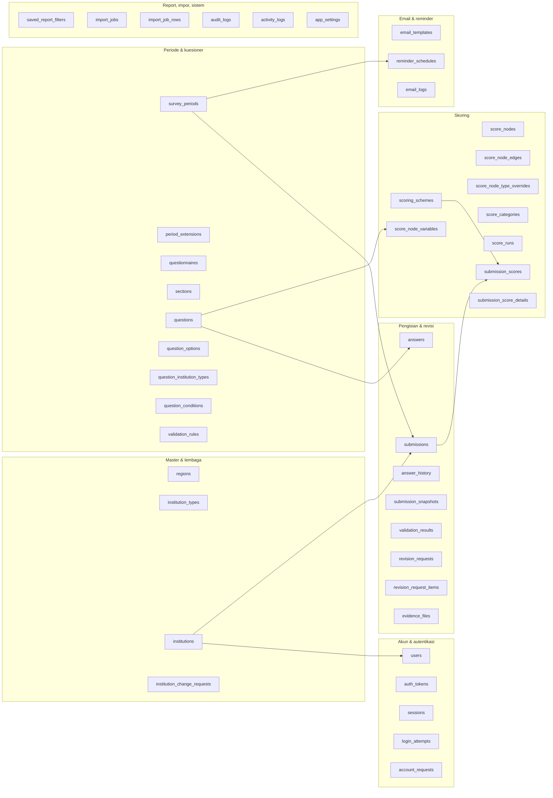
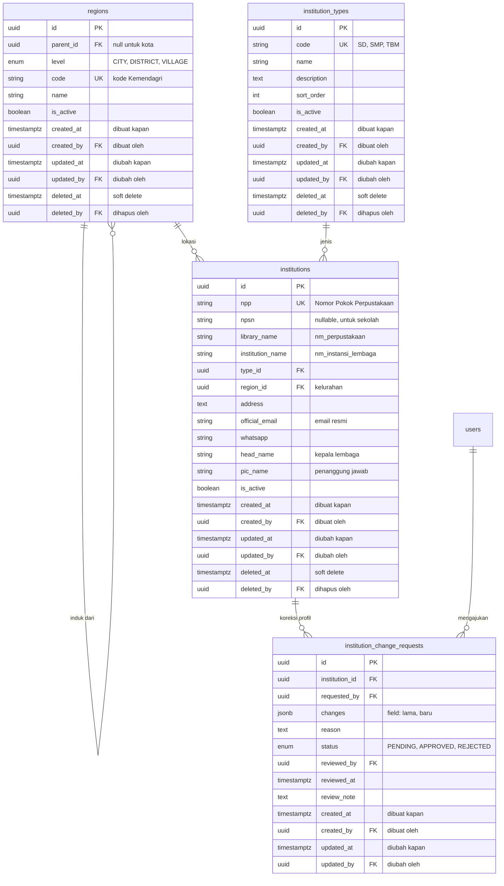
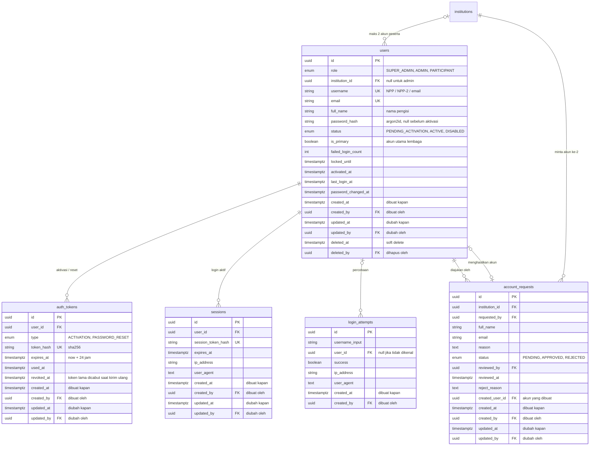
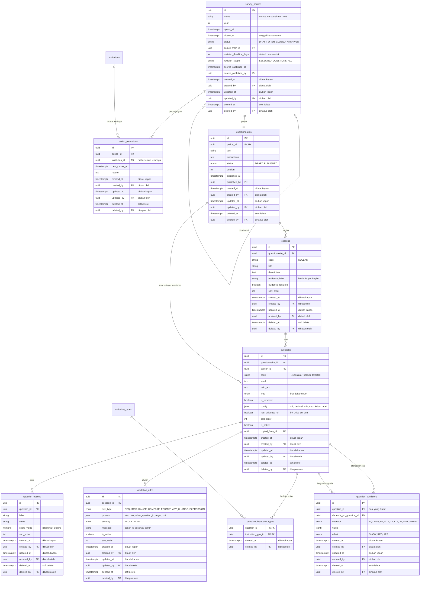
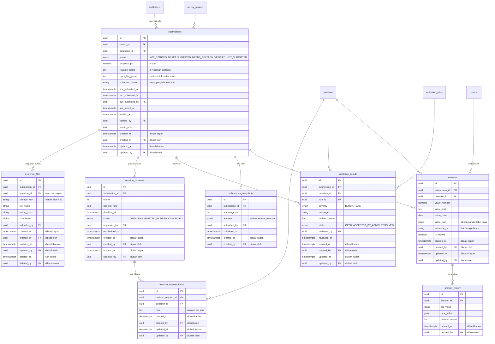
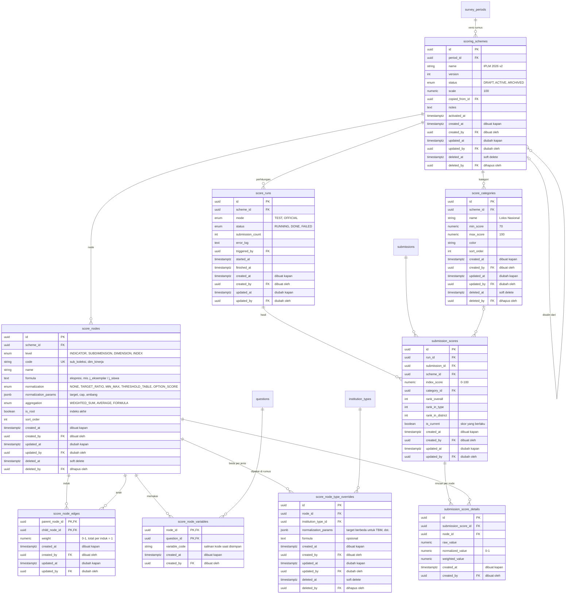
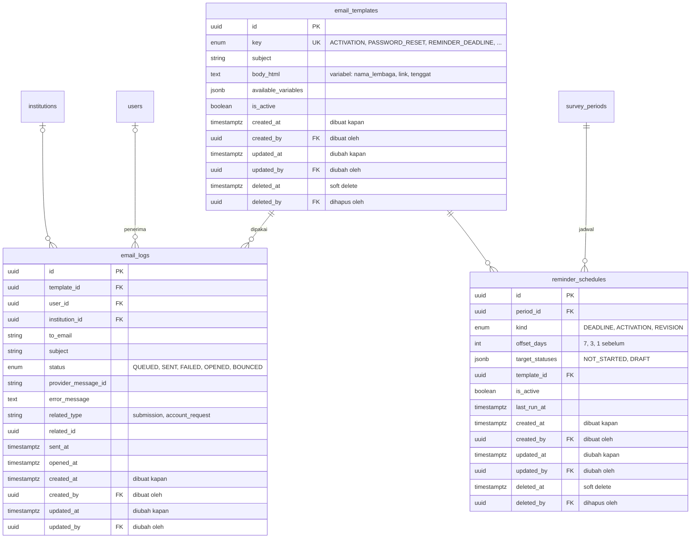
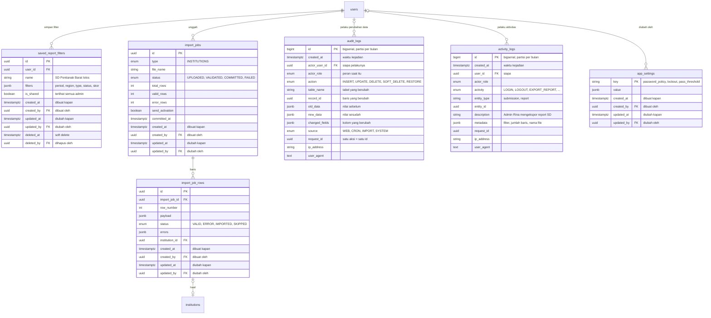
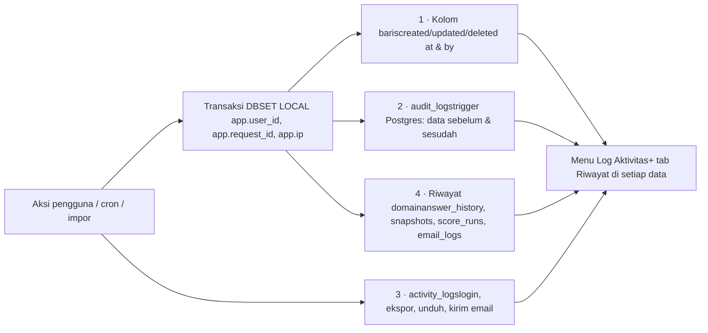

PostgreSQL · Next.js · Vercel

# ERD sistem LibCon

Desain database untuk semua modul di flowchart: lembaga dan wilayah, akun peserta, kuesioner dengan aturan validasi, pengisian dan revisi, mesin skoring yang rumusnya diatur admin, email, report, dan audit.

**44** tabel

**7** domain

**29** enum

## 00 Konvensi

#### Kolom tracking di setiap tabel

| Grup | Kolom |
| --- | --- |
| Master & konfigurasi | `created_at/by` `updated_at/by` `deleted_at/by` |
| Transaksi | `created_at/by` `updated_at/by` |
| Log & riwayat | `created_at/by` (tidak bisa diubah) |

- Semua kolom `*_by` mengarah ke `users.id`. Garisnya tidak digambar supaya diagram tetap terbaca
- Aksi otomatis (cron, trigger, impor) tercatat atas nama user khusus **SYSTEM**, jadi tidak ada kolom `*_by` yang kosong
- `id uuid` PK, kecuali tabel log yang memakai `bigserial` supaya cepat
- Waktu disimpan dalam UTC dan ditampilkan dalam WIB

#### Prinsip desain

- **Per periode**: kuesioner, rumus, dan jawaban terikat ke periode. Menyalin periode berarti menduplikasi baris, tidak mereferensi baris lama
- **Tidak ada hapus permanen** untuk data inti; pakai `is_active` / `deleted_at`
- **Token disimpan sebagai hash**, tidak pernah plaintext
- **Jejak lengkap**: riwayat jawaban, snapshot tiap kirim, versi rumus, audit log

Legenda diagram: `PK` primary key, `FK` foreign key, `UK` unik. Garis `||--o{` berarti satu ke banyak, `|o--o{` berarti relasinya opsional.

## 01 Peta domain

Hubungan antardomain. Tabel **submissions** adalah pusatnya: satu baris per lembaga per periode.

## 02 Master data & lembaga

Wilayah memakai satu tabel bertingkat (kota → kecamatan → kelurahan). Lembaga ditautkan ke kelurahan, jadi kecamatan didapat dari parent-nya. Jenis peserta bisa ditambah admin.

## 03 Akun & autentikasi

Admin dan peserta disimpan di satu tabel `users` dan dibedakan oleh `role`. Untuk peserta `username` = NPP (akun kedua `NPP-2`); untuk admin username = email. Token aktivasi dan reset ada di satu tabel.

Batas 2 akun ditegakkan di dua tempat: pengecekan dalam transaksi saat admin menyetujui request, dan trigger database yang menolak akun peserta ke-3 untuk satu `institution_id`. Partial unique index menjamin hanya ada satu `is_primary = true` per lembaga.

## 04 Periode & kuesioner

Satu periode punya satu kuesioner. Soal punya `code` (kode variabel) yang dipakai di aturan validasi dan rumus skor. Aturan validasi dan logika tampil disimpan sebagai baris terpisah, sehingga admin bisa menambahkan sebanyak yang diperlukan per soal.

#### Contoh `validation_rules.params`

- RANGE: `{"min":0,"max":1000000}`
- COMPARE: `{"op":"GTE","other_question_id":"…judul"}`
- FORMAT: `{"pattern":"drive.google.com"}`
- YOY\_CHANGE: `{"max_pct":50}` dibandingkan dengan jawaban periode lalu lewat `questions.copied_from_id`
- EXPRESSION: `{"expr":"j_siswa > 0 OR jenis != 'SD'"}`

#### Aturan berlaku-untuk

Jika soal tidak punya baris di `question_institution_types`, soal berlaku untuk **semua jenis**. Jika ada barisnya, soal hanya muncul untuk jenis yang terdaftar.

## 05 Pengisian, validasi & revisi

Satu `submission` per lembaga per periode. Jawaban disimpan per soal dalam kolom yang sesuai tipenya. Setiap kali dikirim dibuat snapshot, setiap perubahan jawaban dicatat di riwayat, dan setiap revisi punya daftar soal yang dibuka.

Soal yang terbuka saat revisi ditentukan oleh `revision_request_items` pada revisi berstatus OPEN. Soal lain tetap `is_locked = true`. Jika `revision_scope = ALL`, semua jawaban dibuka.

## 06 Mesin skoring

Rumus disimpan sebagai **graf node**, tidak sebagai pohon biasa. Alasannya, di data IPLM satu indikator bisa masuk ke subdimensi (misalnya Koleksi) dan sekaligus ke dimensi (Kepatuhan atau Kinerja). Tabel `score_node_edges` menampung hubungan banyak-ke-banyak itu beserta bobotnya.

#### Preset dari data contoh

- Node INDEX `indeks_dasar` (root)
- Edge ke `dim_kepatuhan`, bobot 0,30
- Edge ke `dim_kinerja`, bobot 0,70
- Node SUBDIMENSION: koleksi, sdm, pelayanan, pengelolaan
- Node INDICATOR menyusul setelah juknis resmi didapat

#### Cara hitung

Graf dihitung dari bawah ke atas (topological sort). Validasi sebelum aktivasi: tidak boleh ada siklus, total bobot setiap induk = 1, dan semua variabel di rumus harus ada di kuesioner. Rumus dievaluasi dengan parser ekspresi yang aman (misalnya `mathjs` dengan scope terbatas), bukan `eval`.

## 07 Email & reminder

Reminder dijalankan oleh Vercel Cron setiap hari. Sebelum mengirim, sistem mengecek `email_logs` agar email yang sama tidak terkirim dua kali ke lembaga yang sama pada hari yang sama.

## 08 Report, impor & sistem

### Query report (form filter)

Report disusun dengan join: `submissions` ⟶ `institutions` ⟶ `regions` (kelurahan → kecamatan) ⟶ `institution_types`, ditambah `submission_scores` dengan `is_current = true`. Filter rentang skor (misalnya ≥ 70) diterapkan ke `index_score`, dan grafik subdimensi diambil dari `submission_score_details`.

## T Tracking & audit

Setiap kejadian di sistem bisa dijawab: **siapa**, **kapan**, **apa yang berubah**, **dari mana**. Ada empat lapis pencatatan.

#### 1 · Kolom di setiap baris

Menunjukkan siapa yang membuat, terakhir mengubah, dan menghapus sebuah baris. Diisi otomatis oleh Prisma extension dari user yang sedang login. Data tidak dihapus permanen; baris hanya ditandai `deleted_at` dan bisa dipulihkan.

#### 2 · audit\_logs: perubahan data

Trigger Postgres pada **semua** tabel non-log mencatat setiap INSERT, UPDATE, dan DELETE beserta nilai lama, nilai baru, dan kolom yang berubah. Karena dicatat di level database, perubahan tetap terekam meskipun terjadi di luar aplikasi.

#### 3 · activity\_logs: aksi pengguna

Aksi yang tidak mengubah data tapi penting dilacak: login, logout, login gagal, membuka jawaban peserta, ekspor report, unduh rapor, kirim ulang aktivasi, kirim reminder massal.

#### 4 · Riwayat khusus domain

Riwayat yang tampil langsung di layar terkait: perubahan jawaban per soal (`answer_history`), salinan setiap kiriman (`submission_snapshots`), setiap perhitungan skor beserta versi rumusnya (`score_runs`), dan setiap email (`email_logs`).

### Contoh yang bisa ditelusuri

| Pertanyaan | Sumber |
| --- | --- |
| Siapa yang mengubah jumlah eksemplar SDN 24 dari 8.174 menjadi 9.000, dan kapan? | answer\_history + audit\_logs |
| Siapa yang mengubah bobot Kinerja dari 0,70 ke 0,60? | audit\_logs (score\_node\_edges) |
| Siapa yang membuka revisi untuk SMP Suster, dan apa catatannya? | revision\_requests.created\_by + audit\_logs |
| Siapa yang mengekspor data peserta minggu ini? | activity\_logs (EXPORT\_REPORT) |
| Siapa yang menghapus lembaga ini, dan bisakah dipulihkan? | institutions.deleted\_by + audit\_logs.old\_data |
| Apakah email aktivasi benar-benar terkirim? | email\_logs + activity\_logs |

Log bersifat **append-only**: aplikasi tidak punya izin UPDATE/DELETE ke `audit_logs` dan `activity_logs` (dicabut lewat GRANT). Tabel log dipartisi per bulan dan disimpan minimal 5 tahun. Durasi ini bisa diubah di `app_settings`.

## 09 Daftar enum

| Enum | Nilai | Dipakai di |
| --- | --- | --- |
| `user_role` | SUPER\_ADMIN, ADMIN, PARTICIPANT, SYSTEM | users, audit\_logs, activity\_logs |
| `audit_action` | INSERT, UPDATE, DELETE, SOFT\_DELETE, RESTORE | audit\_logs |
| `log_source` | WEB, CRON, IMPORT, SYSTEM | audit\_logs |
| `activity_type` | LOGIN, LOGOUT, LOGIN\_FAILED, ACCOUNT\_LOCKED, PASSWORD\_CHANGED, VIEW\_SUBMISSION, EXPORT\_REPORT, DOWNLOAD\_RAPOR, RESEND\_ACTIVATION, SEND\_BULK\_REMINDER, PUBLISH\_SCORES, RUN\_SCORING, IMPERSONATE\_VIEW | activity\_logs |
| `user_status` | PENDING\_ACTIVATION, ACTIVE, DISABLED | users |
| `token_type` | ACTIVATION, PASSWORD\_RESET | auth\_tokens |
| `request_status` | PENDING, APPROVED, REJECTED | account\_requests, institution\_change\_requests |
| `region_level` | CITY, DISTRICT, VILLAGE | regions |
| `period_status` | DRAFT, OPEN, CLOSED, ARCHIVED | survey\_periods |
| `revision_scope` | SELECTED\_QUESTIONS, ALL | survey\_periods |
| `questionnaire_status` | DRAFT, PUBLISHED | questionnaires |
| `question_type` | INTEGER, DECIMAL, CURRENCY, PERCENT, SHORT\_TEXT, LONG\_TEXT, SINGLE\_CHOICE, MULTI\_CHOICE, YES\_NO, DROPDOWN, DATE, SCALE, URL, TABLE, FILE | questions |
| `condition_operator` | EQ, NEQ, GT, GTE, LT, LTE, IN, NOT\_EMPTY | question\_conditions |
| `condition_effect` | SHOW, REQUIRE | question\_conditions |
| `rule_type` | REQUIRED, RANGE, COMPARE, FORMAT, YOY\_CHANGE, EXPRESSION | validation\_rules |
| `rule_severity` | BLOCK, FLAG | validation\_rules, validation\_results |
| `submission_status` | NOT\_STARTED, DRAFT, SUBMITTED, NEEDS\_REVISION, VERIFIED, NOT\_SUBMITTED | submissions |
| `validation_result_status` | OPEN, ACCEPTED\_BY\_ADMIN, RESOLVED | validation\_results |
| `revision_status` | OPEN, RESUBMITTED, EXPIRED, CANCELLED | revision\_requests |
| `scheme_status` | DRAFT, ACTIVE, ARCHIVED | scoring\_schemes |
| `node_level` | INDICATOR, SUBDIMENSION, DIMENSION, INDEX | score\_nodes |
| `normalization_type` | NONE, TARGET\_RATIO, MIN\_MAX, THRESHOLD\_TABLE, OPTION\_SCORE | score\_nodes |
| `aggregation_type` | WEIGHTED\_SUM, AVERAGE, FORMULA | score\_nodes |
| `run_mode` / `run_status` | TEST, OFFICIAL / RUNNING, DONE, FAILED | score\_runs |
| `email_template_key` | ACTIVATION, PASSWORD\_RESET, ACCOUNT\_LOCKED, REMINDER\_DEADLINE, REMINDER\_ACTIVATION, REMINDER\_REVISION, SUBMISSION\_RECEIPT, REVISION\_OPENED, ACCOUNT\_REQUEST\_APPROVED, ACCOUNT\_REQUEST\_REJECTED, SCORE\_PUBLISHED | email\_templates |
| `email_status` | QUEUED, SENT, FAILED, OPENED, BOUNCED | email\_logs |
| `import_status` / `import_row_status` | UPLOADED, VALIDATED, COMMITTED, FAILED / VALID, ERROR, IMPORTED, SKIPPED | import\_jobs, import\_job\_rows |

## 10 Constraint & index penting

| Tabel | Constraint / index | Tujuan |
| --- | --- | --- |
| institutions | `UNIQUE(npp)`, `INDEX(region_id, type_id)` | NPP sebagai login; daftar peserta per wilayah dan jenis |
| users | `UNIQUE(username)`, `UNIQUE(email)` | Login unik |
| users | `UNIQUE(institution_id) WHERE is_primary` | Satu akun utama per lembaga |
| users | Trigger: maks. 2 baris PARTICIPANT per `institution_id` | Batas akun kedua |
| users | `CHECK(role = 'PARTICIPANT') = (institution_id IS NOT NULL)` | Admin tidak terikat lembaga |
| auth\_tokens | `UNIQUE(token_hash)`, `INDEX(user_id, type) WHERE used_at IS NULL` | Cek token cepat; token lama dicabut |
| questionnaires | `UNIQUE(period_id)` | Satu kuesioner per periode |
| questions | `UNIQUE(questionnaire_id, code)` | Kode variabel unik untuk rumus |
| submissions | `UNIQUE(period_id, institution_id)`, `INDEX(period_id, status)` | Satu kiriman per lembaga; dashboard status |
| answers | `UNIQUE(submission_id, question_id)`, `INDEX(question_id)` | Upsert autosave; report per soal |
| revision\_requests | `UNIQUE(submission_id) WHERE status = 'OPEN'` | Hanya satu revisi terbuka |
| scoring\_schemes | `UNIQUE(period_id) WHERE status = 'ACTIVE'` | Satu rumus aktif per periode |
| score\_nodes | `UNIQUE(scheme_id, code)` | Kode node unik |
| score\_node\_edges | `CHECK(parent_node_id <> child_node_id)` + cek siklus di aplikasi | Graf tanpa siklus |
| submission\_scores | `UNIQUE(submission_id) WHERE is_current`, `INDEX(scheme_id, index_score)` | Satu skor berlaku; filter rentang skor |
| email\_logs | `INDEX(status)`, `INDEX(institution_id, template_id, sent_at)` | Kirim ulang yang gagal; cegah duplikat reminder |
| audit\_logs | `INDEX(table_name, record_id, created_at)`, `INDEX(actor_user_id, created_at)`, `INDEX(request_id)` | Riwayat per data, per pengguna, per aksi |
| activity\_logs | `INDEX(user_id, created_at)`, `INDEX(activity, created_at)` | Filter di menu Log Aktivitas |
| Semua tabel FULL | `INDEX(...) WHERE deleted_at IS NULL` | Query harian tidak menyentuh data terhapus |
| Semua tabel | `FK *_by → users.id`, `NOT NULL` untuk `created_by` | Pembuat setiap baris selalu tercatat |

## 11 Modul flowchart ke tabel

| Modul | Tabel utama |
| --- | --- |
| 02 Master data & periode | regions, institution\_types, survey\_periods, period\_extensions |
| 03 Peserta & aktivasi | institutions, users, auth\_tokens (ACTIVATION), email\_logs |
| 04 Login & keamanan | users, sessions, login\_attempts, auth\_tokens (PASSWORD\_RESET), app\_settings |
| 05 Request akun tambahan | account\_requests, users |
| 06 Builder kuesioner | questionnaires, sections, questions, question\_options, question\_institution\_types, question\_conditions, validation\_rules |
| 07 Pengisian survei | submissions, answers, answer\_history, submission\_snapshots, evidence\_files (nanti) |
| 08 Validasi & revisi | validation\_results, revision\_requests, revision\_request\_items |
| 09 Mesin skoring | scoring\_schemes, score\_nodes, score\_node\_edges, score\_node\_variables, score\_node\_type\_overrides, score\_categories, score\_runs, submission\_scores, submission\_score\_details |
| 10 Monitoring & reminder | submissions (status, progress\_pct), reminder\_schedules, email\_templates, email\_logs |
| 11 Report & analitik | submission\_scores, submission\_score\_details, saved\_report\_filters |
| Profil lembaga | institution\_change\_requests |
| Impor data (tahap akhir) | import\_jobs, import\_job\_rows |
| Lintas modul (tracking) | audit\_logs, activity\_logs, kolom \*\_at/\*\_by di semua tabel, app\_settings |
