Perpustakaan Kota · Lomba Perpustakaan Terbaik

# Flow sistem LibCon

Perpustakaan Kota mendaftarkan lembaga di bawah naungannya, mengirim akun lewat email resmi, menyusun kuesioner beserta aturan validasinya, lalu memantau pengisian sampai skor dan laporan keluar. Semua aturan (jenis, soal, validasi, rumus skor) diatur admin dari sistem.

Next.js · TypeScript · Tailwind · Vercel · Postgres · Cakupan: tingkat kota ·

## 00 Ringkasan & peran

Hanya ada dua sisi. Staf Perpustakaan Kota memakai panel admin penuh. Lembaga peserta hanya melihat menu survei miliknya sendiri.

#### Admin Perpustakaan Kota

- Mengelola master data: wilayah, jenis, periode
- Input dan mengelola peserta, kirim aktivasi
- Menyusun kuesioner, aturan validasi, dan rumus skor
- Memeriksa flag, membuka revisi
- Monitoring, reminder, report, analitik

Login: email + password ·

#### Peserta (lembaga)

- Aktivasi akun dan membuat password
- Mengisi survei periode aktif, simpan draf, kirim
- Memperbaiki jawaban saat diminta revisi
- Melihat skor dan rapornya sendiri
- Mengajukan akun kedua (maks. 2 per lembaga)

Login: NPP + password ·

Admin bisa terdiri dari beberapa staf. Usulan saya: dua level, **Super Admin** (rumus, pengguna admin, pengaturan) dan **Admin** (operasional harian). Keduanya tetap orang Perpustakaan Kota.

## 01 Alur utama

Gambaran satu siklus lomba dari awal sampai akhir, dibagi menurut siapa yang mengerjakan.

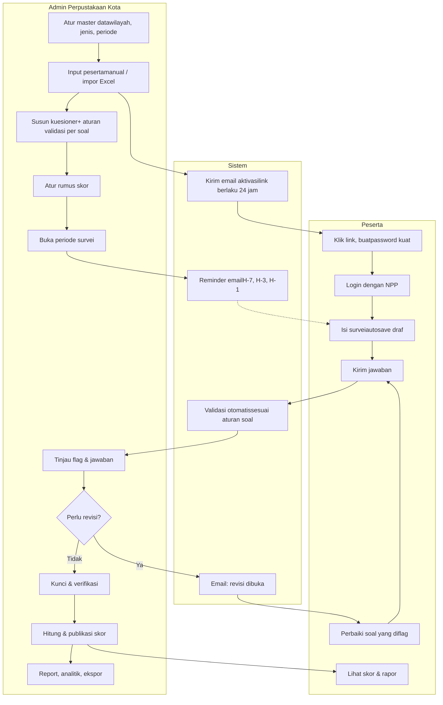

## 02 Master data & periode

Disiapkan sekali, lalu dipakai ulang setiap tahun. Semua bisa diubah admin.

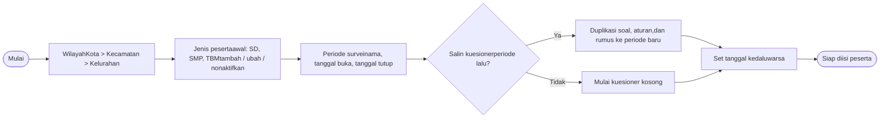

#### Jenis peserta

Hanya satu level, nilai awal **SD, SMP, TBM**. Admin bisa menambah (misalnya LSM, Perpus Kelurahan, Perpus Kecamatan) dan menonaktifkan jenis tanpa menghapus data lama.

#### Periode & kedaluwarsa

Setiap periode punya tanggal buka dan tutup. Setelah tanggal tutup, tombol Kirim terkunci. Admin bisa memperpanjang untuk semua peserta atau untuk peserta tertentu saja.

## 03 Input peserta & aktivasi akun

Admin mengisi data lembaga, lalu sistem membuat akun dengan username = NPP dan mengirim link aktivasi ke email resmi lembaga.

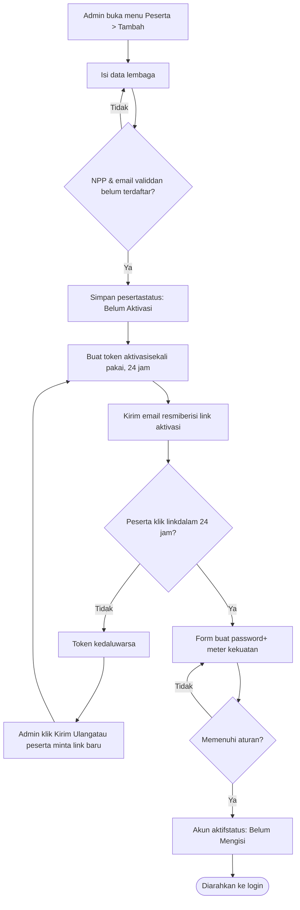

#### Data lembaga (mengikuti format IPLM)

- Nama perpustakaan, nama instansi/lembaga
- **NPP** (username, unik), NPSN
- Jenis peserta
- Alamat, kecamatan, kelurahan
- Nama penanggung jawab/pengisi
- Email resmi, no. WhatsApp

#### Aturan password kuat

- Minimal 10 karakter
- Huruf besar, huruf kecil, angka, simbol
- Tidak boleh memuat NPP atau nama lembaga
- Ditolak jika ada di daftar password umum
- Disimpan sebagai hash (argon2/bcrypt)

Impor massal dari Excel dimasukkan ke menu khusus dan dikerjakan di tahap akhir, sesuai permintaan. Alurnya: unggah file, pratinjau dan validasi per baris, simpan, lalu kirim aktivasi massal.

## 04 Login & keamanan

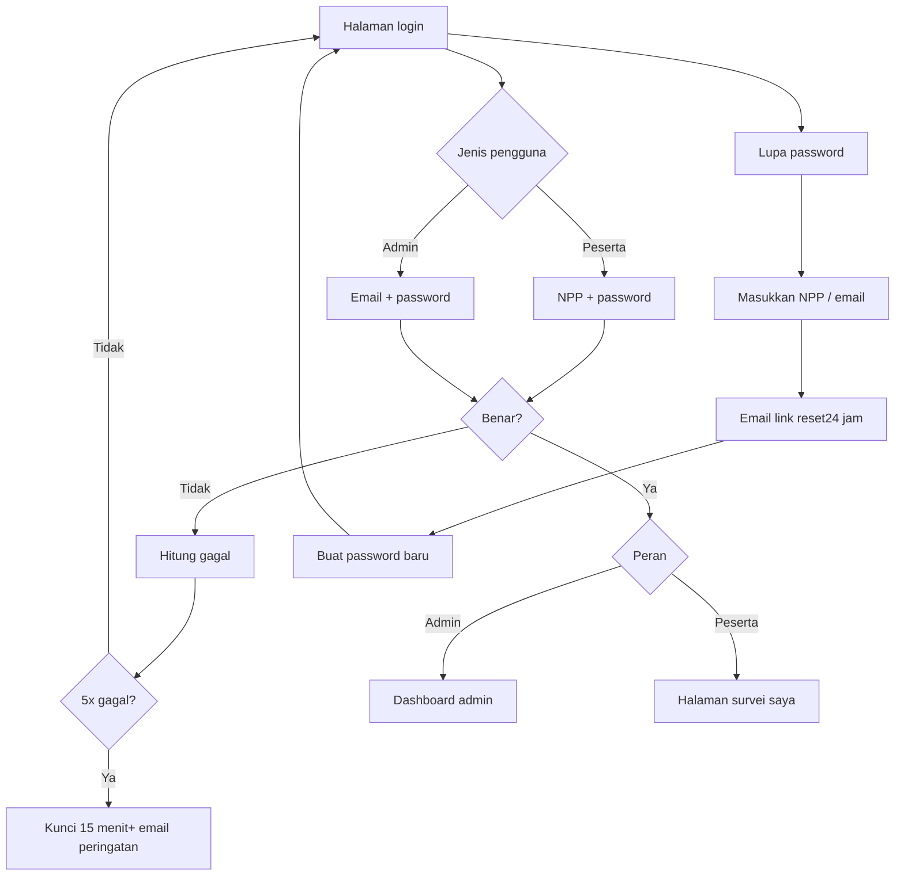

Admin juga bisa mereset password dan menonaktifkan akun peserta. Setiap tindakan penting (login, kirim, revisi, ubah rumus) dicatat di **log aktivitas**.

## 05 Request akun tambahan

Satu lembaga memulai dengan satu akun dan bisa mengajukan satu akun lagi, jadi maksimal dua. Kedua akun mengisi survei yang sama milik lembaga itu.

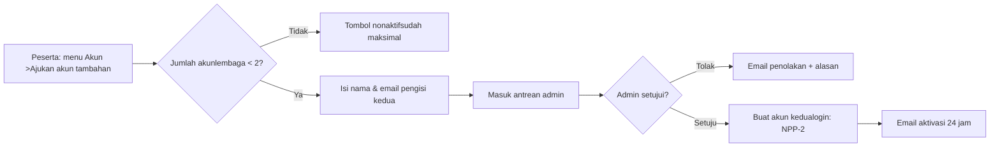

Usulan: akun kedua memakai username NPP-2, karena NPP harus unik per akun. Riwayat edit menyimpan siapa yang mengubah jawaban apa, supaya dua pengisi tidak saling menimpa tanpa jejak.

## 06 Builder kuesioner

Admin menyusun soal per bagian. Setiap soal punya tipe jawaban, berlaku untuk jenis tertentu, aturan validasi sendiri, dan bisa dihubungkan ke rumus skor.

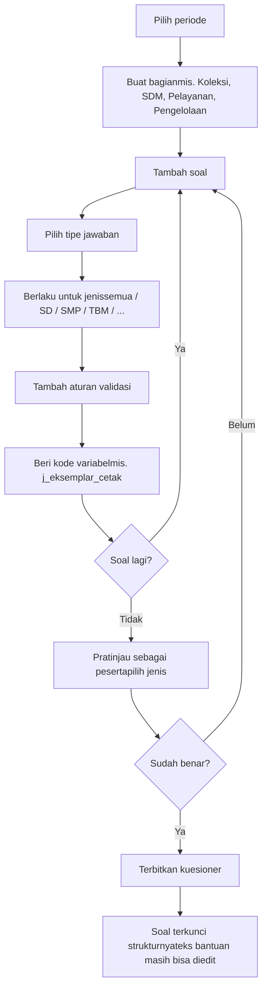

#### Tipe jawaban yang disediakan

Angka bulat · Desimal · Rupiah · Persentase · Teks pendek · Paragraf · Pilihan tunggal · Pilihan ganda · Ya / Tidak · Dropdown · Tanggal · Skala 1–5 · Link (URL) · Tabel isian · Unggah file (nanti) ·

#### Aturan validasi per soal

- **Wajib diisi**
- **Rentang**: min/maks, mis. 0–1.000.000
- **Perbandingan antarsoal**: eksemplar ≥ judul, koleksi termanfaat ≤ total koleksi
- **Format**: URL Google Drive, angka saja
- **Kewajaran**: beri flag jika naik/turun > X% dari tahun lalu
- **Kondisional**: tampil/wajib jika soal lain bernilai tertentu

Setiap aturan bisa diset sebagai Blokir ·  (tidak bisa kirim) atau Flag ·  (boleh kirim, tapi ditandai untuk admin).

## 07 Pengisian survei

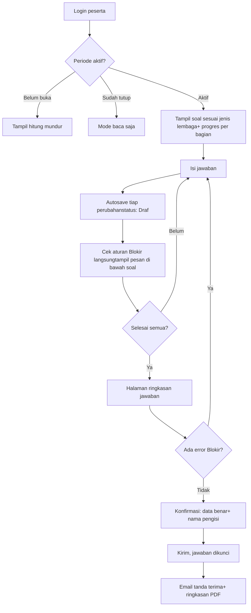

Bukti dukung untuk sementara berupa **link Google Drive** per bagian atau per soal, dengan format folder mengikuti template dari pusat. Fitur unggah file langsung disiapkan untuk nanti.

## 08 Validasi otomatis & revisi

Setelah peserta mengirim, sistem menjalankan semua aturan soal. Jawaban yang melanggar aturan Flag muncul sebagai tanda di panel admin. Admin yang memutuskan perlu revisi atau tidak.

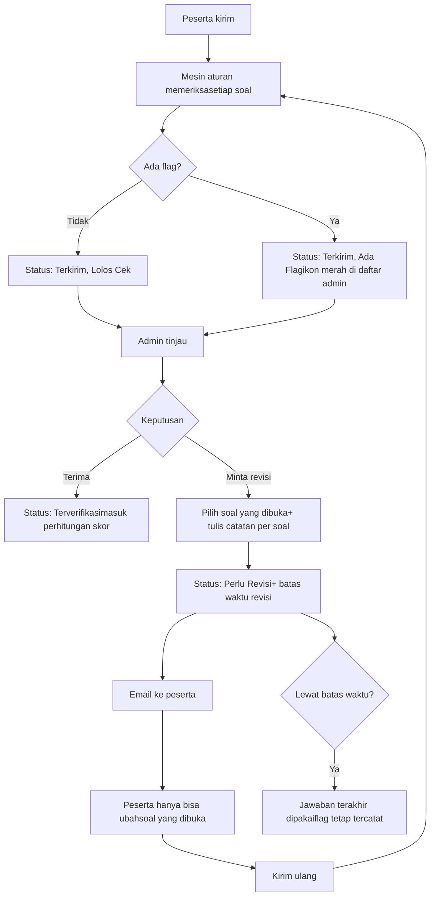

Admin bisa mengatur apakah revisi membuka **soal tertentu saja** (usulan default) atau **seluruh kuesioner**. Setiap putaran revisi disimpan sebagai versi, sehingga perbedaan sebelum dan sesudah revisi bisa dilihat.

## 09 Mesin skoring (rumus diatur admin)

Rumus tidak ditanam di kode. Admin menyusun pohon penilaian: **soal → indikator → subdimensi → dimensi → indeks**. Di setiap level admin memilih cara normalisasi dan bobotnya.

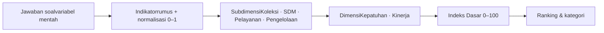

### Cara admin menulis rumus indikator

rasio\_koleksi\_per\_siswa = j\_eksemplar\_cetak / j\_siswa
normalisasi = MIN(nilai / target, 1) ← target diisi admin, mis. 10
atau MIN-MAX antar peserta
atau tabel ambang (0–2 = 0,25 · 2–5 = 0,5 · …)
skor\_subdimensi\_koleksi = Σ (skor\_indikator × bobot) ← bobot total = 100%
Indeks\_Dasar = (0,30 × Kepatuhan + 0,70 × Kinerja) × 100

#### Fitur editor rumus

- Pilih variabel dari soal (autocomplete kode variabel)
- Operator + − × ÷, MIN MAX IF SUM AVG
- Peringatan jika total bobot ≠ 100%
- **Uji rumus**: jalankan pada data contoh sebelum dipakai
- Rumus diberi versi; skor menyimpan versi rumus yang dipakai
- Hitung ulang semua skor saat rumus diubah

#### Preset awal dari data contoh Anda

Saya cek ke 13 baris di file Excel. Indeks Dasar sama dengan **30% Kepatuhan + 70% Kinerja**, dengan selisih maksimal 0,04 poin akibat pembulatan (contoh: Perpustakaan Kota Pontianak, 0,3×0,865 + 0,7×0,858 = 86,01; tercatat 85,99). Pembobotan ini jadi preset awal. Rumus dari indikator ke subdimensi akan diisi saat juknis resmi didapat.

## 10 Monitoring & reminder

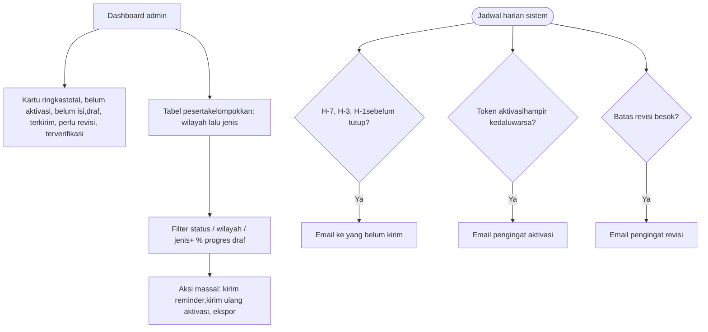

Jadwal reminder (H-berapa) dan isi template email bisa diubah admin. Semua email tercatat di **log email**: terkirim, gagal, atau dibuka.

## 11 Report & analitik

Admin memilih data lewat form filter, lalu melihat grafik dan tabel atau mengekspornya. Peserta melihat skornya sendiri.

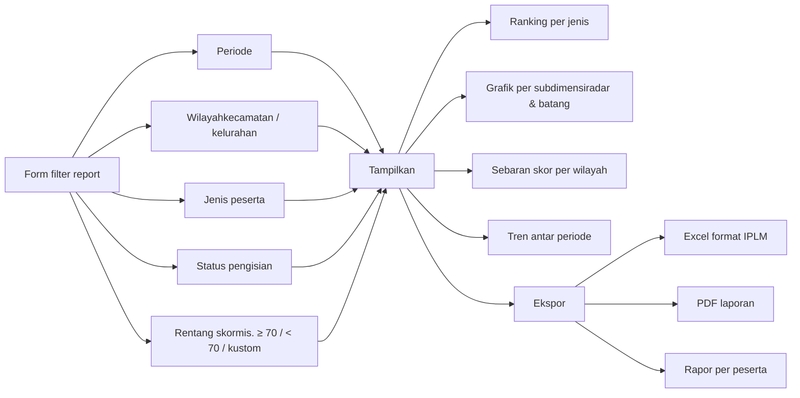

#### Yang dilihat peserta

- Indeks Dasar dan kategori
- Grafik radar empat subdimensi
- Perbandingan dengan rata-rata jenisnya
- Rapor PDF yang bisa diunduh
- Riwayat skor tahun-tahun sebelumnya

#### Kapan skor terlihat peserta

Usulan: skor baru tampil setelah admin menekan **Publikasikan Skor** untuk periode itu, supaya tidak ada skor sementara yang bocor sebelum verifikasi selesai.

## 12 Status peserta

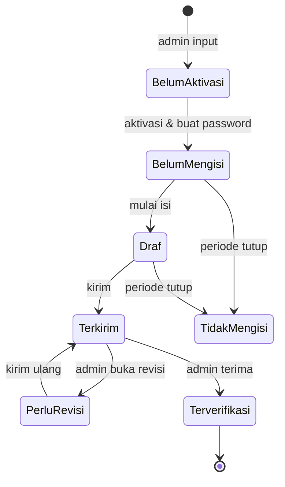

Belum Aktivasi · Belum Mengisi · Draf · 45% · Terkirim · Terkirim · Ada Flag · Perlu Revisi · Terverifikasi · Tidak Mengisi ·

## 13 Hak akses

| Fitur | Super Admin | Admin | Peserta |
| --- | --- | --- | --- |
| Master wilayah, jenis, periode | Penuh | Lihat | – |
| Kelola peserta & aktivasi | Penuh | Penuh | – |
| Setujui akun tambahan | Ya | Ya | Ajukan |
| Builder kuesioner & aturan | Penuh | Penuh | – |
| Editor rumus skor | Penuh | Lihat | – |
| Tinjau flag & buka revisi | Ya | Ya | – |
| Isi survei | – | – | Milik sendiri |
| Publikasi skor | Ya | – | – |
| Report & analitik | Semua | Semua | Skor sendiri |
| Kelola pengguna admin, template email, log | Ya | – | – |

## 14 Struktur menu

#### Panel admin

- **Dashboard**: ringkasan status, grafik progres
- **Peserta**: daftar (per wilayah dan jenis), tambah, detail, kirim ulang aktivasi, reset password
- **Permintaan Akun**: antrean akun kedua
- **Periode Survei**: buat, salin, tanggal kedaluwarsa
- **Kuesioner**: bagian, soal, aturan validasi, pratinjau
- **Verifikasi**: antrean jawaban terkirim, flag, revisi
- **Skoring**: pohon penilaian, editor rumus, uji, hitung ulang, publikasi
- **Report & Analitik**: form filter, grafik, ekspor
- **Pengaturan**: wilayah, jenis, template email, jadwal reminder, admin, log
- **Impor Data**: impor Excel (tahap akhir)

#### Portal peserta

- **Beranda**: status, tenggat, catatan revisi
- **Survei**: isi, progres, ringkasan, kirim
- **Skor Saya**: indeks, radar subdimensi, rapor PDF
- **Profil Lembaga**: lihat data, ajukan koreksi
- **Akun**: ganti password, ajukan akun kedua

## 15 Yang masih ditunggu

Template bukti dukung
:   Format link atau folder Google Drive dari pusat (Anda yang akan tanyakan)

Rumus resmi
:   Cara jawaban mentah menjadi skor indikator dan subdimensi. Sementara memakai preset dari data contoh dan editor rumus.

Indeks\_Final
:   Angka 34,85 di file belum dipakai sampai artinya jelas

Kategori skor
:   Usulan: ≥ 70 lolos ke tahap nasional, tapi batasnya bisa diubah admin
